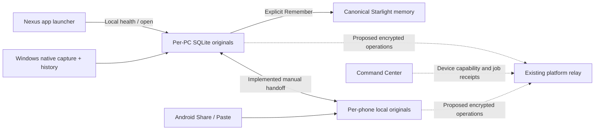

# Starlight across Windows and Android, Codex, 1 November 2026, v1

Author: Codex. Created: 2026-11-01. Revision: v1.
Review state: local beta implementation; independent, physical-phone and public-release acceptance pending.
Sources: Frank's mobile/multi-machine request and direction to build our own product;
Clipboard issue #4/PR #5; existing source a5f09e6; vendor references retrieved this session.

## Decision

Build Starlight's own capture-to-creation experience. Microsoft is an optional
transport; our archive, prompt provenance, creative organization and selected
memory filing remain independent of it. A defensible product hypothesis is the
connection from an original thought through prompt revisions to useful creative
outcomes. That is a hypothesis to validate with creators, not established market
advantage. The new code delivers capture/recovery/transfer, not that entire vision.

Keep the accepted Windows collector and Suite applications. Add a small offline
mobile client now; use Expo/React Native for the native mobile stage. Do not make
a custom keyboard the first milestone. It would become a sensitive product with
typing quality, languages, accessibility, trust and maintenance obligations.

| Direction | Useful outcome | Cost/limit | Decision |
| --- | --- | --- | --- |
| SwiftKey transport plus independent Starlight archive/client | Quick Windows/Android text handoff while we own retention and creative workflows | Latest cloud clip only; delivery and source attribution have gaps | Optional transport now |
| Expo app with explicit Share/Paste, encrypted SQLite and device approval | A native offline library, secure keys and deliberate capture | Needs a custom native build and shared identity/sync implementation | Native product direction |
| Starlight default Android keyboard | Potential access under Android's default-IME exception | Large keyboard product and trust burden; platform/device testing still required | Later demand-led experiment |

## What was implemented

### Windows history bridge

The official WinRT history API is read through a bounded PowerShell5.1 helper.
It reports history/roaming status and reads up to 25 eligible text items. The
existing collector can opt into a single scan every 60 seconds with `clips history
enable`; disable/status/inspect/preview/import are explicit CLI operations.
There is no additional scheduled task, service or account.

Protected clipboard formats and known application metadata are checked before
text retrieval. Credential-like text is skipped before archive insertion. Import
is transactional, preserves normalized source dates, and records unknown original
device attribution honestly. Native occurrences are matched rather than counted
twice. Stable Windows identities can recur at new times; matching receipts make
repeated scans idempotent. Changed source content rolls back the batch.

The helper is limited to 12 seconds and one worker. A 4 GiB safety floor plus a
256 MiB helper reserve defers automatic reads when RAM is low. Disabling during
a read prevents import. Failures write payload-free status. Text/response limits,
protected entries, images, unavailable entries and deadline skips are visible.
The stop command allows the bounded worker to finish gracefully.

The real API probe found history and roaming already enabled on this PC: 25
items, 21 eligible text entries and four protected entries. Its isolated preview
imported zero originals. Windows often omits the original app/title/device;
history cannot reconstruct every original app/title exclusion or identify a phone
as the source. This bridge cannot recover items Windows already discarded.

An actual restored-archive test then added five missing items, matched 16 existing
captures and skipped four protected items. A repeat added zero. All 2,180 baseline
original IDs/text/source dates matched their prior stream hash, and SQLite
integrity passed. This evidence is an isolated private restore, not yet the live
installation result; the installed receipt records that separately.

### Offline mobile capture

`mobile/` implements deliberate Paste, local committed drafts, category/tag choice,
search/date/type filters, full-original reading and private import/export. Browser
storage transactions commit before success is shown. Failed saves retain text;
newer edits survive an earlier pending save/paste. Conflicting source identities
or vibe definitions refuse the complete import. Handoffs preserve labels,
membership and collection definitions even though mobile does not edit vibes yet.

The Android Share Target handler uses a POST body rather than putting private
text into a URL. It commits to IndexedDB before redirecting. A storage failure
returns a local error instead of forwarding the payload. The service worker
pre-caches the shell; shared text is not placed in the asset cache. A web app
must be installed from a trusted HTTPS origin with its worker active to appear
as a share target. This source is not a released APK or installed phone app.

The web beta is plaintext browser storage, bounded to 2,000 originals / 10 MB.
It requests persistent storage only through an explicit button. Browser eviction,
clearing data and loss of the phone still require an exported second copy.
Handoffs retain the desktop 450 KB / 999-original bound. A smaller filtered view
can be exported. Archives are never automatically deleted to make room.

The existing Starlight icon was reused with source/hash provenance. No new
generated visual asset or model call was needed.

The browser library has a stable locally generated identity; each open document
has its own draft identity. These identifiers prevent accidental mixing and do
not imply trusted device enrollment or a shared account. An actual synthetic
JS-to-Windows-to-JS roundtrip preserved source IDs, text, dates and two tags;
the repeat import added zero originals.

## What Android and Microsoft actually allow

Android 10+ restricts clipboard reads to the app with input focus or the default
input method editor. A normal Expo app, a background timer or a foreground service
does not provide unrestricted background clipboard access. Use explicit Share,
Paste, or a supported Microsoft transport. A custom keyboard requires a separate
product and permission decision.
[Android privacy behavior](https://developer.android.com/about/versions/10/privacy/changes#clipboard-data).

SwiftKey Cloud Clipboard supports Android/Windows text transport with the same
personal Microsoft account. Its cloud history retains only the latest clip for
about an hour. It is useful for handoff, but is not an all-copies backup or a
Starlight library-sync protocol. Windows cloud-history arrivals must actually
reach the PC before our history importer can retain them.
[Microsoft SwiftKey instructions](https://support.microsoft.com/en-au/swiftkey-keyboard/how-to-use-microsoft-swiftkey-keyboard-to-copy-and-paste-text-between-swiftkey-and-windows).

## Native mobile build

Reuse the portable domain contract, while replacing the web storage adapter with
Expo SQLite and the UI with native screens. Use Expo Router, an Android incoming
share activity/module, explicit clipboard reads and accessible native navigation.
An outgoing share API alone does not register incoming Android capture.

Use SQLCipher for the native archive and SecureStore/Android Keystore for wrapped
device credentials. Expo's current SQLCipher option needs a custom native build;
it is not available in Expo Go or web, and enabling it does not encrypt an existing
plaintext database automatically. Every connection, including transaction-created
connections, needs correct key initialization. This needs a migration and recovery
test, not a checkbox in app configuration.
[Expo SQLite documentation](https://docs.expo.dev/versions/latest/sdk/sqlite/).

SecureStore's Android keys are device-bound and excluded from backup/transfer.
Biometric changes can invalidate authenticated entries. Google/Microsoft sign-in
does not itself restore content keys. A second approved device or independently
stored recovery material must be tested before calling hardware-loss recovery
complete. Do not build a proprietary cipher or store database keys in Git.
[Expo SecureStore documentation](https://docs.expo.dev/versions/latest/sdk/securestore/).

Motion stays restrained: immediate peer-tab changes, native navigation and a
reduced-motion path. Reanimated is for useful native gestures after an actual
Expo implementation exists. No React Native animation runtime was installed by
this web-client slice.

## Shared identity, sync and machine management

Use the existing platform's account and device authority. Reconcile its pending
desktop grants with actual source before implementing Google/Microsoft login.
Do not introduce another auth server or expose the token-bearing desktop loopback
API to the Internet. The current mobile client has no remote login or sync API.

Command Center already has Tauri bootstrap-installer source in merged PR #85,
commit eeb410a11a812ba3f402f64bbee3cd41be639a3a. Reuse that release work alongside
the existing Nexus app rather than inventing a third installer authority. Its
merged source does not establish that a signed installer is installed on this PC.
[Existing Suite bootstrap work](https://github.com/Starlight-Intelligence/starlight-command-center/pull/85).

Each enrolled device needs an identity, approval, bounded capabilities, last-seen
health and revocation. Capture/library permissions are separate from agent job
execution. A phone's library credential must never grant unrestricted laptop shell
access. Command Center should inspect operation/job receipts and approved machine
capabilities without receiving raw clipboard bodies as routine telemetry.

For future sync, immutable originals keep global source IDs and dates. Upload
encrypted objects and idempotent operations, not live SQLite/WAL files. Preserve
conflicting creative definitions as variants. Explicit archive/state changes must
not become silent destructive retention. Bind encryption envelopes to workspace,
device and operation identity; use reviewed crypto and test key rotation, device
loss, clock skew, retries, offline edits, revocation and wrong-workspace denial.

Follow the existing estate storage/gateway registry. The inspected Nexus guide
names Supabase Postgres and Vercel Blob and says not to expand R2. Its registry
brief/architecture-stack pointers were unresolved in the prior inspection; this
document does not replace that authority. No hosted database/schema, DNS, cloud
credential, new project or paid runner was activated.

Private GitHub holds source and sanitized contracts. Raw archives, keys, personal
prompt bundles and recovery material stay outside Git. MD/JSON, Drive and Notion
are explicit exports/projections. SIS remains the curated memory authority;
capturing every clip does not automatically pollute shared memory.

## AI routing and the product hypothesis

Keep capture independent of AI. The default remains SQLite FTS and local wording
rules. Local CLI agents can work on selected originals and propose provenance-
bearing labels through the existing library interface. Copied instructions remain
untrusted data; classification never authorizes shell execution or deletion.
Do not add an always-running local model to a RAM-constrained host.

Evaluate Clef/Clef-flash for bounded typed decisions; evaluate Clef-omni only when
approved images, audio or video help the task. Cloudflare currently lists Clef
at $0.24/M input tokens and Clef-omni at $0.15/M, without output-token charges.
These are retrieved vendor rates, not measured end-to-end costs or proof of
classification quality. Model probability outputs require evaluation on our own
held-out labels; uncertain results stay suggestions. No cloud model was called
on clipboard contents and no inference budget was activated.
[Clef model](https://developers.cloudflare.com/workers-ai/models/clef/),
[Clef-omni model](https://developers.cloudflare.com/workers-ai/models/clef-omni/).

The potential product distinction is reliable creative continuity: retrieve a
specific old Suno direction, see its source and revisions, connect an actual
track/result, and carry the work between devices with revocable access and tested
recovery. Validate that complete job with creators before making commercial or
moat claims. Current code does not yet link generated tracks or provide encrypted
continuous sync.

## Craft and verification record

| Before refinement | After refinement | Why |
| --- | --- | --- |
| Device indicator could wrap | One-line control with aligned status dot | Keep the header stable on touch screens. |
| Narrow date placeholder | Wider native date input | Preserve a legible native affordance. |
| Row heading repeated its excerpt | First sentence plus remaining text | Show more useful content per screen. |
| A 10px mobile timestamp | Existing 12px type step | Improve legibility and match the design system. |

Emil design engineering and Mobile Native were read and applied to touch targets,
focus, native dialogs, input sizes, viewport/safe areas and immediate interactions.
Animate Expo was read for the native plan; it is not evidence of an Expo app.
Impeccable was applied to the inherited Starlight world. The final detector has no
findings. The first advisory and first screenshots remain in private evidence.

The Python suite passes 71 isolated tests; mobile domain tests pass 11 checks.
Real Chromium source fixtures exercise IndexedDB/Cache API, import atomicity,
draft recovery, fault injection, stale paste/save handling, focus and touch sizes.
Keyboard input was dispatched, touch emulated and source reduced-motion declarations
forced for computed checks. The worker handler was exercised against real browser
storage/cache; a complete installed worker lifecycle and physical Android sharing
have not been proved. Exact source hashes and final counts live in the private
evidence receipt and issue update. No private capture was uploaded for browser QA.

Physical Android/SwiftKey delivery, a trusted production HTTPS origin, signed
native builds, full Suite installation, actual second-laptop continuous sync,
off-device restore/key custody and independent exact-head review remain open.
